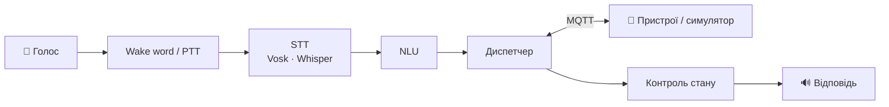

# 🎙️ Teleckinez

**Локальний голосовий асистент для диспетчеризації та контролю станів IoT-пристроїв розумного будинку**

*Offline voice assistant that dispatches commands to smart-home devices over MQTT and verifies they were actually executed.*

> 🚧 Проєкт у розробці (курсова робота, ЛНУ ім. Івана Франка, 2026).
> Повний README з демо, скріншотами і результатами з'явиться наприкінці роботи.

## Ідея

Більшість голосових асистентів працюють за принципом «відправив і забув».
Teleckinez **контролює виконання**: чекає підтвердження від пристрою, звіряє
фактичний стан з бажаним і виявляє збої — пристрій не в мережі, не відповів
або не виконав команду.

## Документація

- [Архітектура](docs/ARCHITECTURE.md) · [Рішення](docs/DECISIONS.md) · [Roadmap](docs/ROADMAP.md)
- Специфікації: [протокол](docs/specs/protocol.md) · [пристрої](docs/specs/devices.md) · [диспетчер](docs/specs/dispatcher.md) · [голос](docs/specs/voice.md) · [NLU](docs/specs/nlu.md) · [веб](docs/specs/web.md) · [метрики](docs/specs/metrics.md)
