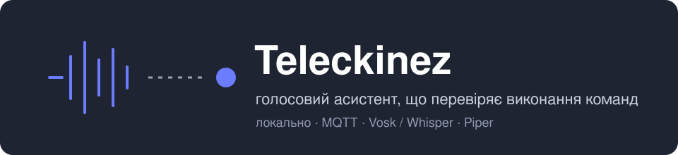
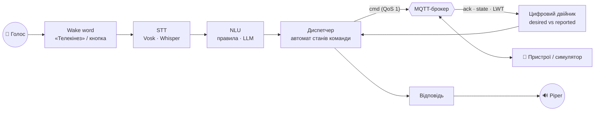
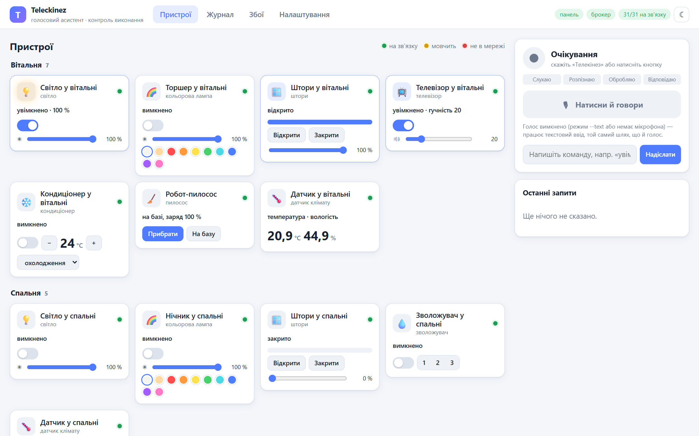
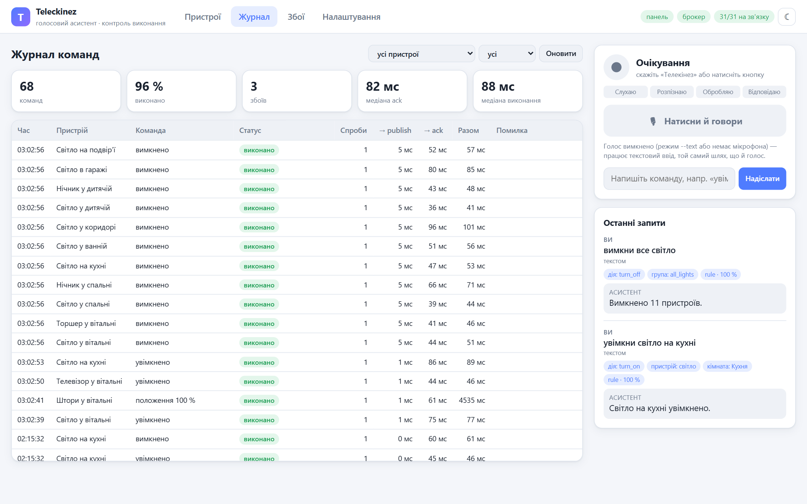
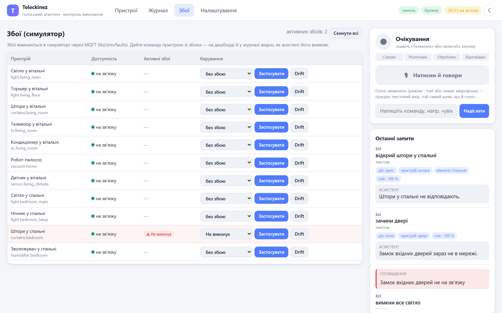
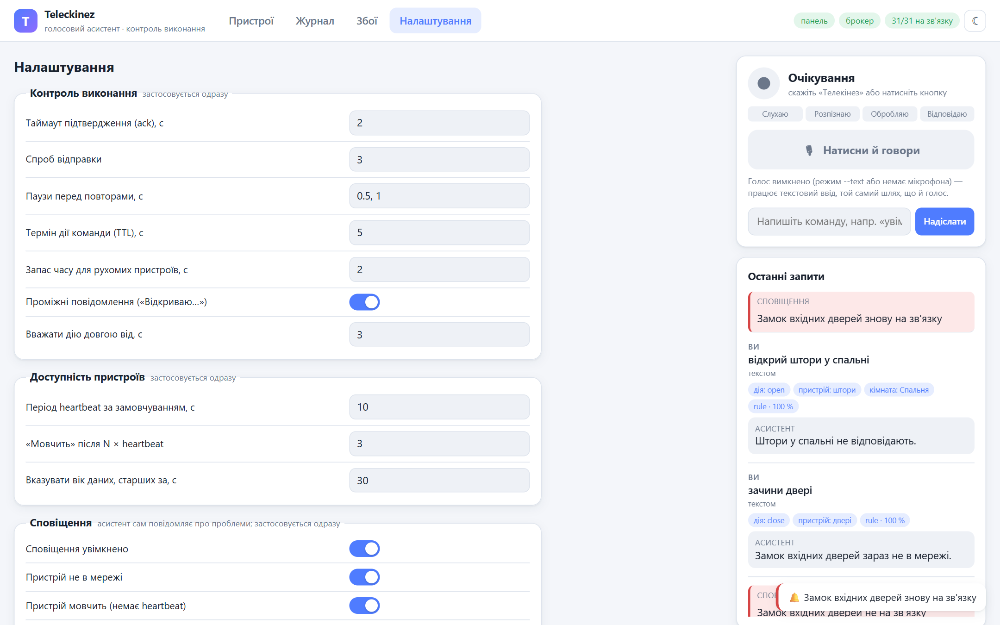

<div align="center">



**Локальний голосовий асистент для диспетчеризації та контролю станів IoT-пристроїв розумного будинку**

*Teleckinez is an offline smart-home voice assistant (Ukrainian and English).
It dispatches commands to devices over MQTT and does not say "done" until the
device's reported state matches the desired one; it detects devices that are
offline, silent, stuck or rejecting commands.*


</div>

<!-- TODO: GIF demo (voice command -> device tile changes -> spoken answer), docs/img/demo.gif -->

## Ідея

Більшість голосових асистентів працюють за принципом «відправив і забув»:
команда пішла в мережу — асистент каже «Готово». Teleckinez **контролює
виконання**. Кожна команда проходить скінченний автомат станів і
завершується лише тоді, коли відомо, що сталося насправді:

| Результат | Відповідь асистента |
|---|---|
| стан пристрою збігся з бажаним | «Штори у вітальні відкрито» |
| пристрій не підтвердив команду після 3 спроб | «Світло у коридорі не відповідає» |
| підтвердив, але стан не змінився | «Штори у спальні: команду прийнято, але стан не змінився» |
| пристрій не в мережі (MQTT Last Will) | «Замок вхідних дверей зараз не в мережі» |
| пристрій відхилив команду | «Кондиціонер: пристрій відхилив команду (…)» |



## Можливості

- **Повністю локально:** розпізнавання (Vosk, faster-whisper), розбір
  команд (правила + fuzzy, опційно локальна LLM через Ollama), синтез (Piper).
- **Українська та англійська:** «увімкни світло на кухні», «штори вітальня»,
  «вимкни все світло», «чи зачинені двері?», «turn off the bathroom light».
- **Контроль виконання:** підтвердження прийому, повтори з тим самим
  `cmd_id`, перевірка збігу стану, виявлення відключення (LWT), «зависання»
  (heartbeat) і змін стану без команди (drift) з голосовими сповіщеннями.
- **Симулятор 31 пристрою** (світло, штори, термостат, замок, ворота, чайник…)
  з фізикою і сімома видами збоїв; уміє імітувати прошивки Tasmota і Zigbee2MQTT.
- **Веб-панель:** дашборд, журнал команд із часом кожного етапу, керування
  збоями, налаштування без перезапуску.
- **Змінні рушії** за спільними інтерфейсами — вибір у `config/settings.yaml`.

## Скріншоти

| Дашборд | Журнал команд |
|---|---|
|  |  |
| **Збої та реакція асистента** | **Налаштування** |
|  |  |

## Швидкий старт (Windows)

Потрібні **Python 3.13** (або 3.12) і, за бажанням, **Docker Desktop**.
Усі команди — у PowerShell у теці проєкту.

1. Створити віртуальне середовище і активувати його:

   ```bash
   py -3.13 -m venv .venv
   ```

   ```bash
   .venv\Scripts\activate
   ```

2. Встановити залежності (`voice` — голос, `broker` — запасний брокер без
   Docker; `cuda` додайте лише для відеокарти NVIDIA):

   ```bash
   pip install -e ".[voice,broker]"
   ```

3. Завантажити моделі (≈1 ГБ у `models/`, один раз):

   ```bash
   python scripts/download_models.py
   ```

4. Запустити MQTT-брокер — Mosquitto у Docker:

   ```bash
   docker compose up -d mosquitto
   ```

   або без Docker (у окремому терміналі):

   ```bash
   python -m teleckinez.broker
   ```

5. У новому терміналі (з активованим `.venv`) запустити симулятор пристроїв:

   ```bash
   python -m simulator
   ```

6. У ще одному терміналі запустити асистента:

   ```bash
   python -m teleckinez
   ```

   Веб-панель: <http://localhost:8000>. Скажіть «Телекінез», дочекайтеся
   сигналу і скажіть команду, або тримайте правий Ctrl і говоріть.
   Без мікрофона: `python -m teleckinez --text` (команди з клавіатури).

## Результати

Вимірювання 03.11.2026 на Ryzen 7 6800H / RTX 3060 Laptop, повністю — у
[benchmarks/results/SUMMARY.md](benchmarks/results/SUMMARY.md). Голосові цифри
поки отримано на мовленні, синтезованому Piper (позначено «синт.»).

| Експеримент | Ключовий результат |
|---|---|
| E1 розпізнавання (синт., 696 кліпів) | Vosk з граматикою — 94,4 % правильних команд, 71 мс; Whisper small — 78,7 %, 142 мс (GPU) |
| E2 розбір команд (276 фраз) | правила 90,6 % за 0,04 мс; LLM qwen2.5:3b 64,5 % за 331 мс; гібрид 91,7 % |
| E3 затримка (синт.) | кінець фрази → звук відповіді: 0,18 с (Vosk), 0,52 с (Whisper) + 0,7 с паузи VAD |
| E4 збої (10 сценаріїв × 20) | правильна реакція в 198 з 200; відключення виявляється за 3 мс, «зависання» — за 7,55 с |
| E5 wake word (синт.) | FRR 0,9 % («Телекінез», Vosk) і 0 % («hey jarvis»); 0 хибних спрацювань на 32 хв мовлення |
| E6 масштаб | 10 → 100 пристроїв: затримка не змінюється (p50 61 мс), групова команда на 100 — 0,13 с |

## Структура репозиторію

```
config/       settings.yaml (рушії, таймаути), devices.yaml (кімнати, пристрої, синоніми)
src/teleckinez/
  core/       шина подій, моделі, конфігурація
  voice/      аудіо, wake word, VAD, STT, TTS, голосовий конвеєр
  nlu/        словник, розбір правилами і LLM, визначення пристроїв
  devices/    типи пристроїв, реєстр, цифрові двійники, health
  dispatch/   диспетчер, автомат станів команди, відповіді, сповіщення
  transport/  MQTT-клієнт, адаптери native / Tasmota / Zigbee2MQTT
  storage/    SQLite-журнал
  web/        FastAPI + WebSocket + статична веб-панель
simulator/    віртуальні пристрої, фізика, збої
benchmarks/   набори даних, скрипти E1–E6, результати
scripts/      завантаження моделей, запис набору, діаграми, збирання записки
docs/         архітектура, рішення, специфікації, діаграми, текст записки
tests/        pytest: юніт- та інтеграційні тести
```

## Документація

- [Архітектура](docs/ARCHITECTURE.md) · [Архітектурні рішення](docs/DECISIONS.md) · [Roadmap](docs/ROADMAP.md)
- Специфікації: [протокол MQTT](docs/specs/protocol.md) · [пристрої і симулятор](docs/specs/devices.md) · [диспетчер](docs/specs/dispatcher.md) · [голос](docs/specs/voice.md) · [NLU](docs/specs/nlu.md) · [веб-панель](docs/specs/web.md) · [метрики](docs/specs/metrics.md)
- Діаграми (PlantUML): [docs/diagrams](docs/diagrams) · текст записки: [docs/report](docs/report)

---

Курсова робота, спеціальність 122 «Комп'ютерні науки», кафедра радіоелектронних і
комп'ютерних систем, Львівський національний університет імені Івана Франка, 2026.
