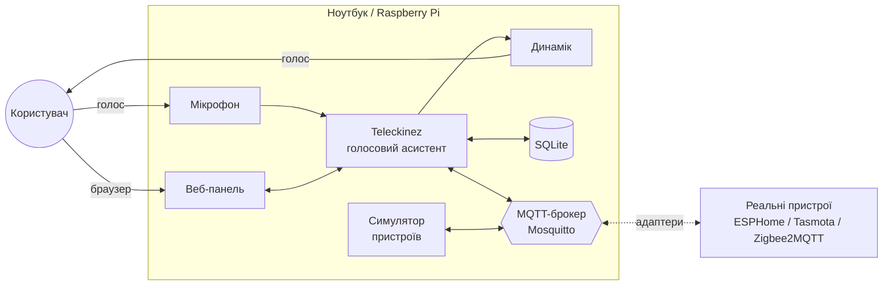
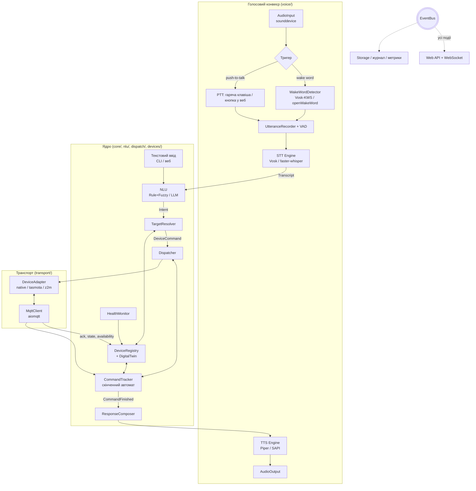
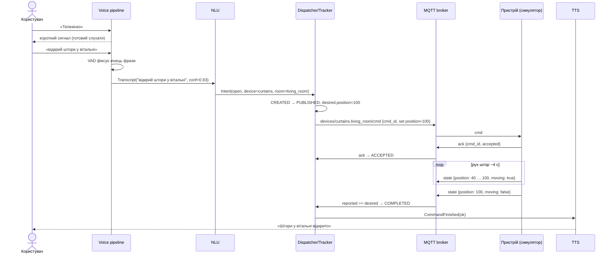

# Архітектура Teleckinez

## 1. Контекст і межі системи

Teleckinez — локальний голосовий асистент розумного будинку. Користувач говорить
у мікрофон ноутбука, асистент розпізнає команду, визначає цільові пристрої,
надсилає їм команди через MQTT-брокер, **контролює виконання** і відповідає
голосом через динамік. Фізичних пристроїв немає — їх замінює **симулятор**, що
поводиться як реальні IoT-вузли (окремий процес, той самий MQTT-протокол,
затримки, збої). Тому заміна симулятора на реальні пристрої (ESP32 з ESPHome/
Tasmota, Zigbee через Zigbee2MQTT) зводиться до додавання **адаптера**, ядро
не змінюється.



## 2. Архітектурний стиль

**Подієво-орієнтований модульний моноліт** + зовнішня шина MQTT
(обґрунтування — ADR-001, ADR-002 у [DECISIONS.md](DECISIONS.md)).

- Усередині процесу асистента модулі не викликають одне одного напряму
  через ланцюжки, а обмінюються **подіями через внутрішню шину** (`EventBus`,
  asyncio pub/sub). Так голосовий конвеєр, диспетчер, веб-панель і
  журналювання слабко зв'язані: веб-панель просто підписується на ті самі
  події, що й TTS.
- Між асистентом і пристроями — **MQTT** (стандарт де-факто для IoT):
  QoS 1, retained-стани, Last Will для виявлення відключень.
- Кожна змінна частина (STT, TTS, wake word, NLU, транспорт) прихована
  за інтерфейсом → **Strategy + Adapter**; конкретна реалізація
  вибирається конфігурацією.
- Симулятор — окремий процес, щоб чесно моделювати мережеву взаємодію.

## 3. Компоненти



| Модуль | Відповідальність | Специфікація |
|---|---|---|
| `core/events.py` | `EventBus`, типи подій (dataclasses) | цей файл, §5 |
| `core/config.py` | Завантаження `settings.yaml`, `devices.yaml` (pydantic) | devices.md |
| `voice/` | Захоплення аудіо, тригер, VAD, STT, TTS | voice.md |
| `nlu/` | Нормалізація тексту, розбір наміру | nlu.md |
| `devices/registry.py` | Каталог пристроїв і синонімів, пошук за кімнатою/типом | devices.md |
| `devices/twin.py` | Цифровий двійник: `desired` vs `reported` стан | dispatcher.md |
| `devices/health.py` | Доступність (LWT, heartbeat), позначення offline/stale | dispatcher.md |
| `dispatch/` | Розсилання команд, автомат життєвого циклу, таймаути, повтори | dispatcher.md |
| `transport/` | MQTT-клієнт, адаптери під формати різних прошивок | protocol.md |
| `storage/` | SQLite: команди, історія станів, голосові сесії | dispatcher.md §7 |
| `web/` | FastAPI, REST + WebSocket, статичний фронтенд | web.md |
| `simulator/` | Віртуальні пристрої, фізика (час руху штор, нагрів), збої | devices.md |
| `benchmarks/` | Експерименти, CSV, графіки для записки | metrics.md |

## 4. Основний сценарій (sequence)



Альтернативні гілки (немає ack, пристрій офлайн, стан не змінився) —
у [specs/dispatcher.md](specs/dispatcher.md).

## 5. Події внутрішньої шини

Усі події — `@dataclass(frozen=True)` з полями `ts` і `session_id` (зв'язує
весь ланцюжок від wake word до відповіді — потрібно для вимірювання затримок).

| Подія | Хто публікує | Хто слухає |
|---|---|---|
| `WakeDetected` / `ListeningStarted` | voice | web, metrics |
| `SpeechEnded` | voice (VAD) | metrics |
| `TranscriptReady(text, lang, confidence, engine)` | STT / текстовий ввід | NLU, web, storage |
| `IntentParsed(intent)` / `IntentFailed(reason)` | NLU | dispatcher, response, web |
| `CommandCreated / CommandStatusChanged / CommandFinished` | tracker | response, web, storage |
| `DeviceStateChanged(device_id, reported, ts)` | registry | tracker, web, storage |
| `DeviceAvailabilityChanged(device_id, online)` | health | tracker, response, web |
| `SpeakRequested(text, lang)` / `SpeakFinished` | response / TTS | web, metrics |

## 6. Структура репозиторію

```
Teleckinez/
├── CLAUDE.md, README.md, pyproject.toml, docker-compose.yml, .env.example
├── config/
│   ├── settings.yaml        # вибір рушіїв, таймаути, мова, порти
│   ├── devices.yaml         # кімнати, пристрої, синоніми uk/en
│   └── mosquitto/mosquitto.conf
├── src/teleckinez/
│   ├── __main__.py          # composition root: збирає все за конфігом
│   ├── core/                # events, config, models, logging
│   ├── voice/               # audio_io, triggers/, vad, stt/, tts/
│   ├── nlu/                 # normalizer, lexicon, rule_parser, llm_parser
│   ├── devices/             # registry, twin, health, capabilities
│   ├── dispatch/            # dispatcher, tracker (FSM), response
│   ├── transport/           # mqtt_client, adapters/{native,tasmota,z2m}
│   ├── storage/             # db, repositories
│   └── web/                 # app, ws, static/{index.html, app.js, style.css}
├── simulator/               # окремий пакет: devices/, faults.py, __main__.py
├── benchmarks/              # datasets/, run_*.py, results/
├── tests/                   # unit + інтеграційні (з реальним брокером)
├── scripts/                 # download_models, record_dataset, render_diagrams, build_report
├── models/                  # (gitignored) Vosk, Whisper, Piper, wake word
└── docs/
    ├── ARCHITECTURE.md, ROADMAP.md, DECISIONS.md, REPORT_PLAN.md
    ├── specs/               # детальні специфікації модулів
    ├── diagrams/            # *.puml, *.mmd → *.png для записки
    └── report/              # тексти розділів записки (*.md) + build → .odt
```

## 7. Розгортання

- **Розробка/демо:** усе на ноутбуці — Mosquitto у Docker, асистент і
  симулятор як два Python-процеси, браузер на `localhost:8000`.
- **Цільове (теоретичне, для записки):** Raspberry Pi 4/5 з USB-мікрофоном
  і динаміком як хаб; Mosquitto на тому ж Pi; пристрої — ESP32 з реле/
  драйверами двигунів під ESPHome або Tasmota у Wi-Fi, Zigbee-пристрої через
  USB-координатор і Zigbee2MQTT. На Pi замість faster-whisper — Vosk
  (менші вимоги до ресурсів) — це аргумент на користь змінних рушіїв.

## 8. Нефункціональні вимоги (цільові значення)

| Характеристика | Ціль |
|---|---|
| Робота без інтернету | 100 % функцій |
| Затримка «кінець фрази → початок відповіді» (Vosk, p50) | ≤ 1,5 с без урахування фізичного руху пристрою |
| Затримка «команда → ack» у локальній мережі | ≤ 100 мс |
| Виявлення відсутності відповіді пристрою | ≤ `ack_timeout` (2 с за замовчуванням) |
| Виявлення відключення пристрою | ≤ 1 с (LWT) / ≤ 3 × heartbeat |
| Точність розпізнавання команд (обмежена граматика) | ≥ 90 % |
| Кількість пристроїв у симуляції | 25+ без помітного навантаження |
