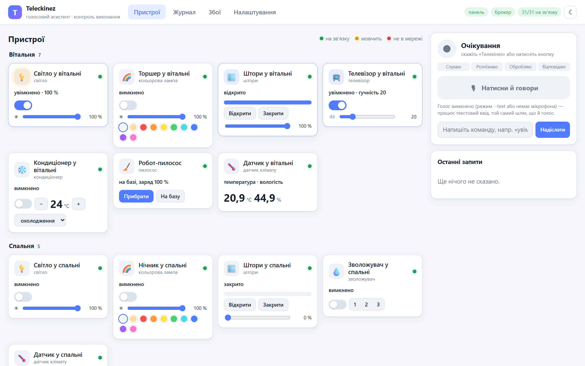

# РОЗДІЛ 3. ПРОЄКТУВАННЯ АРХІТЕКТУРИ СИСТЕМИ

## 3.1. Загальна архітектура

Систему описано за моделлю C4 [6]: спершу контекст (хто і що взаємодіє з
системою), далі контейнери і компоненти. На рівні контексту (рис. 3.1)
Teleckinez — програма на домашньому комп'ютері, з якою мешканець говорить
через мікрофон і динамік або працює через браузер. З пристроями асистент
спілкується лише через MQTT-брокер, тому для нього немає різниці між
симулятором і реальними пристроями з прошивками Tasmota, ESPHome чи
мостом Zigbee2MQTT.

{width=11cm}

Система складається з трьох процесів: асистент, симулятор пристроїв і
MQTT-брокер. Компоненти асистента показано на рис. 3.2. Вони згруповані в
пакети, які відповідають каталогам вихідного коду:

- `voice` — аудіоввід і вивід, тригери (ключове слово, кнопка), VAD,
  розпізнавання і синтез мовлення, конвеєр, що з'єднує їх;
- `nlu` — нормалізація тексту, словник дій, розбір за правилами, розбір
  мовною моделлю, визначення цільових пристроїв (`TargetResolver`);
- `devices` — каталог типів пристроїв, реєстр пристроїв із синонімами,
  цифрові двійники і монітор доступності;
- `dispatch` — диспетчер, автомат станів команди, формування відповідей і
  голосових сповіщень;
- `transport` — MQTT-клієнт і адаптери форматів прошивок;
- `storage` — запис подій у SQLite;
- `web` — REST API, WebSocket і статичні файли веб-панелі;
- `core` — шина подій, моделі даних і завантаження конфігурації.

{width=16cm}

Модулі не викликають один одного ланцюжками. Кожен публікує в шину
`EventBus` типізовані події — `TranscriptReady`, `IntentParsed`,
`CommandStatusChanged`, `DeviceStateChanged`, `SpeakRequested` тощо — і
підписується на ті, що йому потрібні. Кожна подія має час створення і
ідентифікатор сесії, який проходить через весь ланцюжок від ключового
слова до голосової відповіді. Завдяки цьому веб-панель, журнал у базі
даних і скрипти вимірювань є просто ще одними підписниками: щоб виміряти
затримку кожного етапу, не довелося змінювати жодного модуля.

Усі компоненти створюються в одному місці — класі `App` (корінь
композиції), який читає `config/settings.yaml` і `config/devices.yaml`,
вибирає реалізації рушіїв і з'єднує їх через шину. Інтерфейси рушіїв
описано як `typing.Protocol`, наприклад розпізнавач мовлення має один
метод `transcribe(audio, lang) -> Transcript`. Реалізацій кілька: Vosk у
вільному режимі та з граматикою, faster-whisper на відеокарті та
процесорі. Аналогічно оформлено синтез (Piper, SAPI), тригер (Vosk, 
openWakeWord, кнопка) і розбір команд (правила, мовна модель, гібрид).

## 3.2. Голосовий конвеєр

Конвеєр (`voice/pipeline.py`) — це дві асинхронні задачі. Перша читає з
мікрофона кадри по 30 мс (16 кГц, моно, 16 біт) і проводить їх через
стани `IDLE → LISTENING → RECOGNIZING`; друга озвучує кожну подію
`SpeakRequested`. Поки асистент говорить, мікрофон не обробляється
(напівдуплексний режим) — інакше асистент чув би власну відповідь.

Тригер працює в одному з двох режимів. У режимі ключового слова
розпізнавач Vosk постійно слухає з граматикою, у якій є всі слова команд і
слово «Телекінез». Початкова версія використовувала граматику з одного
ключового слова і «невідомого слова», але тоді декодеру не було з чого
вибирати, і схожі слова («телевізор») приймалися за звертання. Розширена
граматика разом із порогом впевненості 0,8 усунула ці спрацювання.
Якщо людина вимовляє звертання і команду одним реченням («Телекінез,
увімкни світло на кухні»), решта фрази одразу йде на розбір без
повторного запису. Кнопка «натисни і говори» (правий Ctrl або кнопка у
веб-панелі) доступна завжди і є запасним варіантом для шумного
приміщення.

Після тригера лунає короткий сигнал, і починається запис. VAD (WebRTC,
агресивність 2) визначає початок фрази за трьома мовними кадрами поспіль,
а кінець — за 700 мс тиші; до запису додається 300 мс аудіо перед
початком мовлення, щоб не обрізати перший склад. Якщо 5 с ніхто не
говорить, запис скасовується. Записаний фрагмент передається
розпізнавачу в окремому потоці, щоб не блокувати цикл подій.

Повний сценарій «звертання — команда — виконання — відповідь» показано на
діаграмі послідовності (рис. 3.3). Важливо, що відповідь формується не
після відправлення команди, а після того, як диспетчер зафіксував
результат виконання.

{width=16cm}

## 3.3. Модель пристроїв і цифровий двійник

Модель пристроїв має три рівні (рис. 3.4). **Можливість** (`Capability`) —
атрибут стану з типом і межами: `on: bool`, `brightness: int 1..100`,
`position: int 0..100`, `target_temp: float 16..30`. **Тип пристрою**
(`DeviceType`) — набір можливостей, підтримувані дії і правило збіжності.
**Пристрій** (`Device`) — екземпляр типу з ідентифікатором, кімнатою,
синонімами українською та англійською, групами і ознакою критичності.

{width=12cm}

Тип пристрою перетворює дію на **абсолютний бажаний стан**: «увімкни» дає
`{"on": true}`, «яскравіше» при поточній яскравості 40 % — `{"brightness":
60}` (крок 20 %), «відкрий штори наполовину» — `{"position": 50}`. Асистент ніколи не
надсилає відносних команд на кшталт «перемкни» чи «додай 10», бо повтор
такої команди змінив би стан двічі. Абсолютна команда ідемпотентна, а
перевірка виконання зводиться до порівняння двох словників. Правило
збіжності для більшості типів таке: усі атрибути бажаного стану мають
дорівнювати звітованим, а пристрій, що рухається, вважається таким, що ще
не виконав команду, поки не зупиниться:

```python
def converged(self, desired: State, reported: State) -> bool:
    for key, value in desired.items():
        if key not in reported or not self.cap(key).equal(reported[key], value):
            return False
    # Moving devices are done only when they stopped at the target.
    return not reported.get("moving", False)
```

Порівняння виконує можливість, а не оператор `==`: для температури
допускається похибка, а колір порівнюється за назвою з каталогу. Для
термостата бажаний стан містить уставку `target_temp`, а не поточну
температуру, тому команда «встанови 22 градуси» виконана, щойно термостат
прийняв уставку, а не через пів години, коли кімната нагріється.

Для кожного пристрою асистент тримає **цифровий двійник** (`DigitalTwin`):
звітований стан із часом і порядковим номером, бажаний стан (об'єднання
бажаних станів усіх незавершених команд або `None`), доступність
(`online`, `offline`, `stale`, `unknown`) і час останнього повідомлення.
Порядковий номер `seq` дозволяє відкинути застаріле повідомлення, яке
прийшло пізніше за новіше. Якщо стан змінився, а бажаного стану немає, — це
**дрейф**: хтось змінив пристрій в обхід асистента. Двійник публікує
`DeviceStateChanged` з позначкою `drift`, а для критичних пристроїв
асистент повідомляє голосом: «Увага: замок вхідних дверей відчинено без
команди».

Конфігурація будинку зберігається в `config/devices.yaml`. Для кімнат
задаються назви в різних відмінках і форма для відповіді («на кухні»), для
пристроїв — синоніми, групи, критичність і протокол. Фрагмент конфігурації
наведено в додатку Б. Під час запуску конфігурація перевіряється: унікальні
ідентифікатори, існуючі кімнати і типи, відсутність однакових синонімів у
різних пристроїв однієї кімнати.

## 3.4. Протокол обміну

Для пристроїв розроблено власний MQTT-контракт (табл. 3.1). Усі топіки
мають префікс `tkz/`, далі ідентифікатор пристрою.

Table: Таблиця 3.1 – Топіки протоколу обміну з пристроями

| Топік | Напрям | QoS | Retain | Вміст |
|---|---|---|---|---|
| `tkz/dev/{id}/meta` | пристрій → | 1 | так | опис можливостей |
| `tkz/dev/{id}/availability` | пристрій → | 1 | так | `online` / `offline` (LWT) |
| `tkz/dev/{id}/state` | пристрій → | 1 | так | повний стан, `ts`, `seq` |
| `tkz/dev/{id}/cmd` | → пристрій | 1 | ні | `cmd_id`, бажаний стан, `ttl_s` |
| `tkz/dev/{id}/ack` | пристрій → | 1 | ні | `cmd_id`, `accepted` / `rejected` |
| `tkz/sim/faults` | → симулятор | 1 | ні | увімкнення та вимкнення збоїв |

Команда має унікальний ідентифікатор `cmd_id` у форматі ULID (сортується
за часом створення) і час життя `ttl_s`: пристрій ігнорує команду, яка
прийшла запізно, і не виконує вдруге команду з уже баченим `cmd_id`, лише
повторно надсилає підтвердження. Стан пристрій публікує завжди повністю,
а не різницею, — після кожної зміни і періодично кожні `heartbeat_s`
секунд; періодична публікація і є сигналом «я живий».

Приклад команди і відповідей пристрою:

```json
cmd:   {"cmd_id": "c-01JB…", "action": "set", "params": {"position": 100}, "ttl_s": 5}
ack:   {"cmd_id": "c-01JB…", "status": "accepted"}
state: {"position": 40, "moving": true, "seq": 182}
state: {"position": 100, "moving": false, "seq": 186}
```

Реальні прошивки не знають цього контракту, тому між диспетчером і MQTT
стоїть **адаптер**. Адаптер `native` працює з протоколом вище; адаптери
`tasmota` і `zigbee2mqtt` перетворюють бажаний стан на команди цих прошивок
(`cmnd/{topic}/Backlog = Power ON; Dimmer 40` для Tasmota [27],
`zigbee2mqtt/{name}/set = {"state":"ON","brightness":102}` для
Zigbee2MQTT [30]) і нормалізують їхні звіти. Ці прошивки не мають
окремого підтвердження, тож адаптер вважає підтвердженням першу відповідь
пристрою після команди, а остаточним успіхом — так само збіг стану.

## 3.5. Диспетчер і життєвий цикл команди

Диспетчер отримує від `TargetResolver` список команд `DeviceCommand`
(пристрій, дія, параметри). Резолвер на попередньому кроці вже визначив
пристрої: за типом і кімнатою, за групою («все світло») або за назвою.
Якщо за фразою підходять пристрої в кількох кімнатах, команда не
створюється, а асистент перелічує варіанти: «Знайшов витяжку на кухні та
у ванній — назвіть кімнату». Вгадування тут небезпечніше за перепитування.

Кожна команда проходить скінченний автомат станів (рис. 3.5). Таблицю
переходів задано в коді явно, і будь-який перехід, якого в ній немає,
викликає виняток:

```python
TRANSITIONS: dict[S, frozenset[S]] = {
    S.CREATED: frozenset({S.PUBLISHED, S.REJECTED_LOCAL, S.DEVICE_OFFLINE}),
    S.PUBLISHED: frozenset({S.ACCEPTED, S.REJECTED, S.RETRYING, S.TIMEOUT_ACK,
                            S.COMPLETED, S.DEVICE_OFFLINE, S.SUPERSEDED}),
    S.RETRYING: frozenset({S.PUBLISHED, S.ACCEPTED, S.REJECTED, S.COMPLETED,
                           S.TIMEOUT_ACK, S.DEVICE_OFFLINE, S.SUPERSEDED}),
    S.ACCEPTED: frozenset({S.COMPLETED, S.TIMEOUT_STATE,
                           S.DEVICE_OFFLINE, S.SUPERSEDED}),
}
TERMINAL = frozenset(s for s in S if s not in TRANSITIONS)
```

{width=15cm}

Сім кінцевих станів відповідають семи різним відповідям користувачу
(табл. 3.2).

Table: Таблиця 3.2 – Кінцеві стани команди та відповіді асистента

| Стан | Що сталося | Приклад відповіді |
|---|---|---|
| COMPLETED | стан пристрою збігся з бажаним | «Штори у вітальні відкрито» |
| REJECTED_LOCAL | дія не підтримується, значення поза межами або брокер недоступний | «Чайник: ця дія не підтримується» |
| REJECTED | пристрій відхилив команду | «Кондиціонер: пристрій відхилив команду (…)» |
| TIMEOUT_ACK | немає підтвердження після всіх спроб | «Світло в коридорі не відповідає» |
| TIMEOUT_STATE | команду прийнято, але стан не змінився | «Штори у спальні: команду прийнято, але стан не змінився» |
| DEVICE_OFFLINE | пристрій не в мережі до або під час виконання | «Замок вхідних дверей зараз не в мережі» |
| SUPERSEDED | надійшла новіша команда тому самому атрибуту | «…: команду замінено новішою» |

Автомат приводять у рух два джерела. **Події пристрою** — підтвердження,
звіт стану, зміна доступності — обробляються синхронно в момент
надходження. Підтвердження переводить команду в `ACCEPTED`, кожен звіт
стану перевіряє збіжність для всіх активних команд пристрою, повідомлення
LWT переводить їх у `DEVICE_OFFLINE`. **Час** контролює окрема
асинхронна задача-наглядач для кожної команди. Вона публікує команду, чекає
підтвердження `ack_timeout` (2 с), за його відсутності повторює публікацію
з тим самим `cmd_id` після паузи 0,5 с, потім 1 с — усього три спроби. Після
`ACCEPTED` наглядач чекає збігу стану не довше за час виконання для типу:
2 с для світла, 12 с для воріт, а для штор — час проходження потрібної
відстані з поточною швидкістю плюс запас:

```python
for attempt in range(1, cfg.max_attempts + 1):
    if attempt > 1:
        self._move(record, S.RETRYING)
        await self._wait_while(record, (S.RETRYING,), cfg.backoff(attempt))
        if record.status is not S.RETRYING:
            break  # a late ack/state arrived during the pause
    self._move(record, S.PUBLISHED)
    await self.sender.send(record.device_id, record.cmd_id,
                           record.desired, cfg.cmd_ttl_s)
    await self._wait_while(record, WAITING_FOR_ACK, cfg.ack_timeout_s)
    if record.status is not S.PUBLISHED:
        break
```

Функція `_wait_while` не просто спить: вона прокидається, щойно статус
команди змінився через подію пристрою. Тому швидкий пристрій отримує
результат за десятки мілісекунд, а таймаути впливають лише на проблемні
випадки.

Два уточнення стосуються гонок. Стан пристрою може збігтися з бажаним
раніше, ніж прийде підтвердження (пристрій уже був у цьому стані або
повідомлення прийшли в іншому порядку), тому існує прямий перехід
`PUBLISHED → COMPLETED`. Під час паузи перед повтором може прийти
запізніле підтвердження попередньої спроби — воно дійсне, бо має той
самий `cmd_id`. Якщо нова команда хоче іншого значення спільного атрибута
(«вимкни світло» відразу після «увімкни світло»), стара команда
переходить у `SUPERSEDED`: її бажаний стан уже ніколи не буде досягнуто, і
чекати на нього немає сенсу. Однакові значення не конфліктують:
«яскравість 40 %» і «зроби синім» обидві неявно містять `on: true` і
обидві перевіряються до кінця.

Групова команда («вимкни все світло») створює по команді на кожен
пристрій, об'єднані в `CommandGroup`. Відповідь формується, коли всі
команди групи завершилися, і містить кількість виконаних команд та
проблемні пристрої: «Вимкнено 5 з 6 пристроїв», далі — що саме сталося з
шостим.

Окремо від команд працює **монітор доступності**. Повідомлення LWT від
брокера одразу позначає пристрій як `offline`. Якщо пристрій має живе
з'єднання, але не надсилав нічого довше за три періоди heartbeat, він
стає `stale` — так виявляється «зависання», при якому LWT не спрацює.
Відключення, повернення і дрейф критичних пристроїв асистент озвучує,
але з паузою для кожного пристрою, щоб пристрій, який «блимає», не
говорив щосекунди. Сценарій збою показано на рис. 3.6.

{width=16cm}

## 3.6. Симулятор пристроїв і модель збоїв

Симулятор — окремий процес, який читає ту саму конфігурацію `devices.yaml`
і для кожного пристрою створює об'єкт `SimDevice` з **власним
MQTT-з'єднанням**. Спільне з'єднання для всіх пристроїв було б простішим,
але тоді LWT не працював би для окремого пристрою, і виявлення
відключення перевірялося б нечесно. Кожен пристрій публікує опис
можливостей, доступність і стан, обробляє команди з урахуванням
ідемпотентності за `cmd_id` і моделює затримку мережі (20–80 мс) та
фізику: штори і ворота рухаються з постійною швидкістю і публікують
проміжні положення, термостат повільно наближає температуру до уставки,
чайник і бойлер нагрівають воду, розетка показує споживану потужність.

Через службовий топік `tkz/sim/faults` будь-якому пристрою можна ввімкнути
збій (табл. 3.3). Збій `offline` імітує обрив TCP-з'єднання без пакета
відключення, тому брокер розсилає LWT так само, як для пристрою, що
втратив живлення.

Table: Таблиця 3.3 – Модель збоїв симулятора

| Збій | Поведінка пристрою | Очікувана реакція асистента |
|---|---|---|
| `offline` | обрив з'єднання | DEVICE_OFFLINE за LWT |
| `freeze` | з'єднання живе, пристрій мовчить | повтори, TIMEOUT_ACK, далі `stale` |
| `drop_rate: p` | губить частку p команд | повтор рятує команду |
| `stuck` | підтверджує, але стан не змінює | TIMEOUT_STATE |
| `slow: ms` | відповідає із затримкою | залежно від `ack_timeout` |
| `reject` | відхиляє команду | REJECTED |
| `drift` | сам змінює стан | подія дрейфу, сповіщення |

Збої вмикаються з веб-панелі (для демонстрації) або скриптом
експерименту, який проходить сценарії з файлу `fault_scenarios.yaml`
(розділ 4). Симулятор уміє також «прикидатися» пристроєм із прошивкою
Tasmota або Zigbee2MQTT — так перевіряються адаптери без справжнього
обладнання.

## 3.7. Веб-панель і зберігання даних

Веб-панель працює в процесі асистента на FastAPI. REST API надає стан
будинку (`GET /api/devices`), журнал команд (`GET /api/commands`),
налаштування (`GET/PUT /api/settings`), приймає текстові команди і
керування збоями симулятора. Через WebSocket `/ws` браузер отримує ті
самі події шини, що й решта модулів, тому плитки пристроїв, індикатор
стану конвеєра і журнал оновлюються без перезавантаження сторінки. Панель
має чотири екрани: дашборд з пристроями за кімнатами, голосова панель з
розпізнаним текстом і відповіддю, журнал команд із часом кожного етапу і
налаштування (рис. 3.7).

{width=16cm}

Журнали зберігаються в SQLite (рис. 3.8). Таблиця `voice_sessions` містить
час кожного етапу голосової сесії, `commands` — команди з усіма часовими
мітками автомата, `state_history` — історію станів із позначкою джерела
(звіт чи дрейф), `availability_log` — зміни доступності. Записує їх
окремий підписник шини `EventRecorder`, тож жоден модуль не залежить від
бази даних.

{width=9cm}

## 3.8. Перехід до реальних пристроїв

Прототип перевірено з симулятором, але архітектура розрахована на
реальне розгортання (рис. 3.9). Хабом може бути Raspberry Pi 4 або 5 з
USB-мікрофоном і динаміком, на якому працюють Mosquitto, асистент і
веб-панель. На такому комп'ютері немає відеокарти, тому розпізнавач
перемикається на Vosk у налаштуваннях — саме для цього рушії зроблено
змінними.

{width=16cm}

Виконавчі пристрої будуються на ESP32 з прошивкою ESPHome [8] або Tasmota
[27]. Наприклад, світильник на 230 В керується модулем реле: вивід GPIO
ESP32 через транзисторний ключ (модулі реле зазвичай мають його на
платі) керує котушкою реле, контакти якого розривають фазовий провід
лампи; модуль живиться від окремого блока живлення 5 В, а земля ESP32 і
модуля об'єднується. Прошивка Tasmota в такій конфігурації сама публікує
`tele/{topic}/LWT` і `stat/{topic}/RESULT`, тобто дає асистенту все
необхідне для контролю виконання. Zigbee-пристрої (датчики, лампи,
приводи штор) під'єднуються через USB-координатор і Zigbee2MQTT [30].
Для переходу до реальних пристроїв у `devices.yaml` достатньо змінити
поле `protocol` і адресу пристрою — ядро асистента не змінюється.

Для реального розгортання потрібні заходи безпеки, які в демонстраційній
конфігурації вимкнено: окремі логіни і паролі для кожного клієнта
брокера, списки доступу (пристрій може писати лише у свої топіки) і TLS
на порту 8883. Для критичних пристроїв (замок, ворота) доцільно додати
підтвердження команди або розпізнавання мовця.
