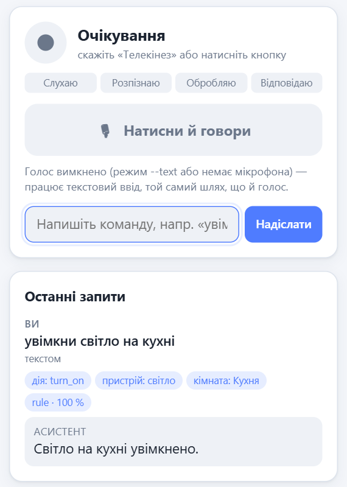
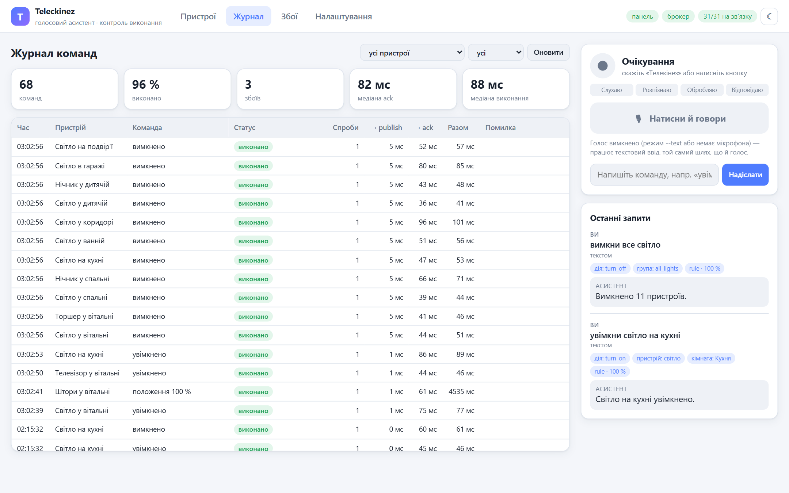
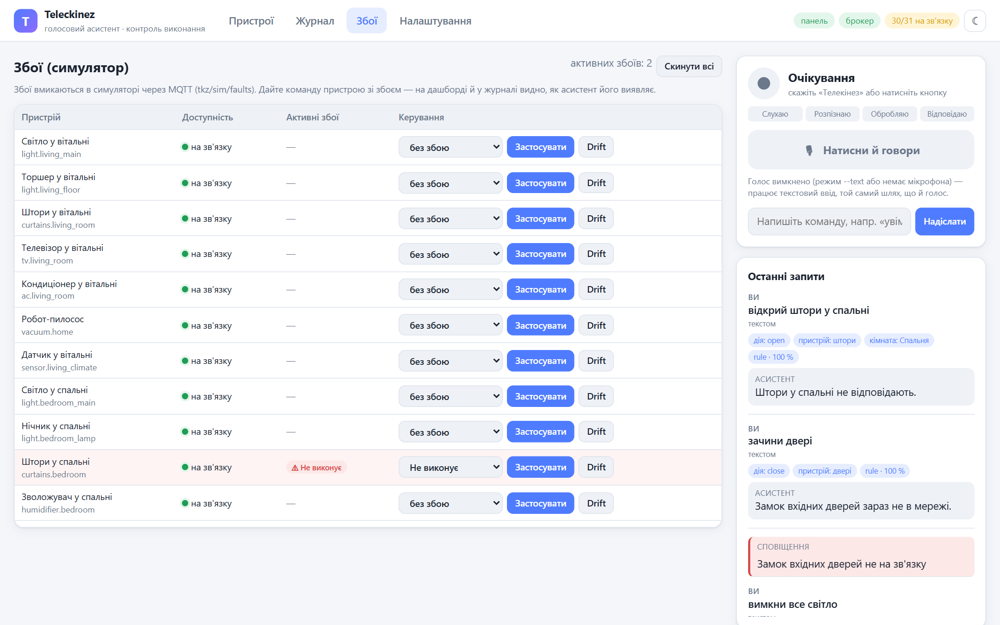
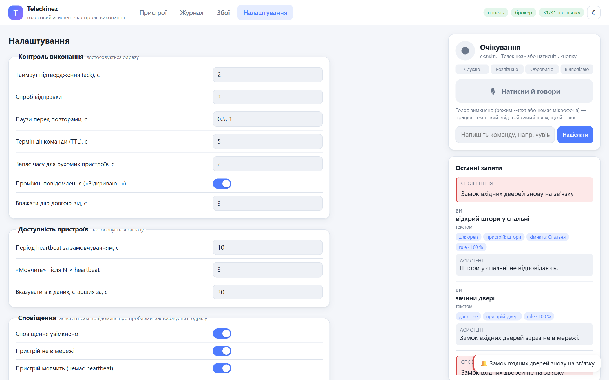

# РОЗДІЛ 4. РЕАЛІЗАЦІЯ, ТЕСТУВАННЯ ТА ОЦІНКА

## 4.1. Ключові аспекти реалізації

Прототип реалізовано мовою Python 3.13. Вихідний код асистента і
симулятора займає близько 8,9 тис. рядків, автоматичні тести — близько
4,7 тис. рядків. Робота велася невеликими кроками за планом з окремим
комітом на кожен пункт; рішення, які відходили від початкової
специфікації, спершу фіксувалися в документації.

**Асинхронність і потоки.** Увесь асистент працює в одному циклі подій
asyncio. Операції, що займають процесор десятки чи сотні мілісекунд, —
розпізнавання фрази, синтез відповіді, виклик мовної моделі —
виконуються через `asyncio.to_thread`, щоб цикл подій тим часом обробляв
повідомлення MQTT і запити веб-панелі. Обробка одного аудіокадру детектором
ключового слова займає в середньому близько 1 мс, тому вона виконується
безпосередньо в циклі подій. На Windows клієнт aiomqtt вимагає
`SelectorEventLoop`, оскільки використовує `add_reader`, якого немає в
циклі за замовчуванням, тому всі точки входу запускають цикл через
спільну функцію.

**Шина подій.** `EventBus` зберігає список підписок, кожна з яких
містить обробник і типи подій, що його цікавлять. Синхронні обробники
викликаються одразу під час публікації, а кожен асинхронний отримує
власну чергу і задачу-обробник, тож повільний підписник (запис у базу,
синтез мовлення) не затримує інших і бачить події в порядку публікації. Події оголошено як незмінні `dataclass`
з полями `ts` і `session_id`. Помилка в одному обробнику записується в
журнал і не зупиняє інших підписників — збій веб-панелі не повинен
зупинити виконання команди.

**Шляхи з кирилицею.** Нативні бібліотеки Vosk (Kaldi) і espeak-ng
(усередині Piper) на Windows не відкривають файли за шляхом з
не-ASCII символами, а проєкт лежить у теці з українською назвою. Замість
перенесення проєкту моделі передаються цим бібліотекам за відносним або
коротким (8.3) шляхом.

**Відеокарта для faster-whisper.** Для інференсу на GPU потрібні бібліотеки
cuBLAS і cuDNN. Щоб не встановлювати CUDA Toolkit, їх узято з
pip-пакетів NVIDIA, а теки з DLL додаються до шляху пошуку під час
запуску. Без відеокарти той самий рушій працює на процесорі з
квантуванням int8.

**Тестування.** Набір містить 559 автоматичних тестів pytest. Юніт-тести
перевіряють автомат станів (зокрема, що недопустимий перехід викликає
виняток), розбір фраз, визначення цільових пристроїв, формування
відповідей і адаптери прошивок. Інтеграційні тести запускають справжній
брокер і симулятор та проходять повний шлях «текст → команда → MQTT →
пристрій → стан → відповідь» для кожного типу збою. Тести з моделями
розпізнавання, з відеокартою і з мовною моделлю позначено окремими
мітками, щоб швидкий прогін займав близько 20 с. Для голосових модулів
передбачено два шляхи перевірки без мікрофона: текстовий режим
(`--text`) і подача WAV-файлу замість мікрофона (`--audio-file`).

## 4.2. Методика експериментів

Проведено шість експериментів (табл. 4.1). Кожен виконується окремим
скриптом із каталогу `benchmarks/`, який зберігає сирі результати у CSV,
зведені — у JSON разом з умовами запуску (процесор, пам'ять, відеокарта,
версії бібліотек), і будує графік.

Table: Таблиця 4.1 – Експерименти

| № | Що вимірюється | Дані | Метрики |
|---|---|---|---|
| E1 | розпізнавання мовлення: Vosk вільний, Vosk з граматикою, Whisper small на GPU і CPU | 696 синтезованих кліпів | WER, CER, точність речень і команд, RTF, затримка |
| E2 | розбір команд: правила, мовна модель, гібрид | 276 фраз з розміткою | точність наміру, пристроїв, параметрів, повного збігу; затримка |
| E3 | затримка повного ланцюжка за етапами | текстові команди; синтезовані голосові кліпи | медіана і p95 кожного етапу |
| E4 | виявлення збоїв | 10 сценаріїв × 20 повторів | частка правильних реакцій, час виявлення, відновлення повтором |
| E5 | детектор ключового слова | синтезовані кліпи зі звертанням і без | FRR, хибні спрацювання на мовленні |
| E6 | масштабованість | 10, 25, 50, 100 пристроїв | час запуску, CPU і пам'ять, затримка, групова команда |

**Апаратні умови.** Усі вимірювання виконано на ноутбуці з процесором
AMD Ryzen 7 6800H, 16 ГБ оперативної пам'яті і відеокартою NVIDIA GeForce
RTX 3060 Laptop (6 ГБ) під Windows 11, Python 3.13.2.

**Брокер.** E3, E4 і E6 виконано з брокером Mosquitto 2.1.2, запущеним як
служба Windows (Docker Desktop на цьому комп'ютері не запустився).
Попередні запуски на запасному брокері amqtt 0.12.1 дали ті самі
результати з точністю до кількох мілісекунд; їх збережено для
порівняння.

**Синтезовані голосові дані.** Набір записів живих голосів на момент
вимірювань ще не зібрано. Щоб перевірити методику і отримати порівняльні
цифри, ті самі 138 фраз (94 українською, 44 англійською) озвучено
синтезатором Piper: три українські голоси та один англійський, кожен з
двома–трьома швидкостями мовлення, усього 696 кліпів. Синтезоване мовлення
чистіше за живе (немає шуму, акценту, нечіткої вимови), тому результати E1,
E3 і E5 на ньому є оптимістичною оцінкою і в таблицях позначені як
синтетичні. Ті самі скрипти без змін запускаються на живих записах, щойно
вони з'являться.

**Розмітка команд.** Набір для E2 містить 276 фраз (186 українською, 90
англійською) в 11 категоріях: прості команди, відмінки і синоніми, фрази
без дієслова, групові команди, команди з параметром, відносні зміни,
запити стану, неоднозначні фрази, типові помилки розпізнавання, вільні
формулювання і сторонні фрази, які асистент має відхилити. Мітка описує,
що мала на увазі людина, а не що повертає парсер, тому помилки
розмічувача не «підганяють» результат. Повним збігом вважається
правильний тип наміру, дія, набір пристроїв і параметри.

**Затримка.** Часові мітки беруться з подій шини (усі події мають
`time.time()` і спільний ідентифікатор сесії), тож вимірювання не
змінює коду асистента. Для команд обчислюються етапи: публікація
(створення → відправка), ack (відправка → підтвердження), збіг стану,
формування відповіді та синтез.

## 4.3. Результати експериментів

### Розпізнавання мовлення (E1)

Результати на синтезованому наборі наведено в табл. 4.2 і на рис. 4.1.
Колонка «команда» показує частку кліпів, для яких розпізнаний текст після
розбору правилами дає правильну команду; саме вона важлива для асистента.

Table: Таблиця 4.2 – Розпізнавання мовлення на синтезованому наборі (696 кліпів)

| Рушій | WER, % | Команда, % (uk / en) | Затримка p50, мс | RTF |
|---|---|---|---|---|
| Vosk, граматика (CPU) | 4,9 | 94,4 (96,1 / 87,1) | 71 | 0,027 |
| Vosk, вільний словник (CPU) | 13,9 | 87,4 (87,8 / 85,6) | 182 | 0,066 |
| Whisper small (GPU, float16) | 21,4 | 78,7 (74,8 / 95,5) | 142 | 0,052 |
| Whisper small (CPU, int8) | 20,9 | 79,2 (75,4 / 95,5) | 1882 | 0,689 |

{width=16cm}

Обмеження граматикою виявилось найефективнішим прийомом: Vosk із
граматикою помиляється в словах утричі рідше, ніж у вільному режимі, і
працює вдвічі швидше. Whisper small на англійських фразах майже не
помиляється (WER 0,3 %), але на українських синтезованих фразах неправильно
розставляє межі слів («Вимкнилю стру у вітальні», «Чори вітальня»). Цей
результат не варто узагальнювати на живе мовлення: український голос
Piper звучить штучно, а Whisper навчався на записах людей. Перевірка на
живих записах автора — [ЧЕКАЄ: E1 живі записи]. Для поточної конфігурації
за замовчуванням обрано Vosk із граматикою, що також відповідає меті
запускати асистента на Raspberry Pi без відеокарти.

### Розбір команд (E2)

Порівняння трьох режимів на 276 розмічених фразах наведено в табл. 4.3,
розбивку за категоріями — на рис. 4.2.

Table: Таблиця 4.3 – Точність і затримка розбору команд (276 фраз)

| Режим | Повний збіг, % | Намір, % | Пристрої, % | Параметри, % | Затримка p50 / p95, мс |
|---|---|---|---|---|---|
| Правила + fuzzy | 90,6 | 91,3 | 93,5 | 88,7 | 0,04 / 0,28 |
| LLM (qwen2.5:3b) | 64,5 | 69,9 | 77,8 | 75,8 | 331 / 452 |
| Гібрид | 91,7 | 92,0 | 93,1 | 93,5 | 0,05 / 363 |

{width=16cm}

Правила впевнено обробляють усе, що передбачено словником: прості команди
(97,4 %), фрази без дієслова, групові команди, параметри і запити стану
(100 %). Слабкі місця — вільні формулювання на кшталт «на кухні
темнувато» (13,3 %) і фрази з помилками розпізнавання (76,2 %). Мовна
модель тут допомагає (40,0 % і 71,4 %), але в решті категорій поступається
правилам: плутає «вимкни» з «увімкни», домислює кімнату, якої не названо
(неоднозначні фрази — 8,3 %), а фрази без дієслова сприймає як запити.
Гібрид викликав модель лише для 32 фраз із 276 і дав найкращий загальний
результат (91,7 %), але відхиляє сторонні фрази гірше за правила (75 %
проти 100 %): модель намагається «знайти» команду навіть у фразі, що не
стосується будинку. Виграш у 1,1 п. п. не виправдовує затримки 0,36 с у
кожній десятій фразі, тому за замовчуванням використовується режим
правил.

### Затримки (E3)

Розкладку затримки за етапами показано на рис. 4.3. Від моменту, коли
VAD зафіксував кінець фрази, до першого звуку відповіді з Vosk минає
170 мс (p95 215 мс), з Whisper на відеокарті — 293 мс (p95 422 мс). До
цього слід додати 700 мс тиші, після яких VAD вирішує, що людина
договорила. Отже, відчутна затримка становить близько 0,9 с для Vosk і
1,0 с для Whisper, що вкладається в ціль 1,5 с (табл. 1.2). У текстовому
режимі від введення команди до звуку відповіді минає 105 мс.

Перший запуск показав для Whisper 402 мс розпізнавання проти 142 мс в
E1. Причина — зниження частот ноутбучної відеокарти в простої: між
фразами вона секундами не працює, і перший виклик після паузи 3–6 с
триває 370–400 мс. Тому, поки асистент слухає команду, розпізнавач
кожні 0,5 с обробляє коротку тишу і до кінця фрази відеокарта вже
працює на повній частоті; після цього розпізнавання в конвеєрі
займає 175 мс.

{width=16cm}

Найдовший етап після розпізнавання — очікування підтвердження від
пристрою (близько 60 мс), і він майже повністю складається зі штучної
затримки симулятора 20–80 мс. Власні етапи асистента — розбір, публікація,
перевірка збігу стану й формування відповіді — разом займають менше 1 мс.
Контроль виконання, таким чином, не робить асистента повільнішим: він
лише чекає реальної відповіді пристрою, яку fire-and-forget-асистент
просто пропустив би.

### Надійність (E4)

Результати 10 сценаріїв збоїв по 20 повторів наведено в табл. 4.4 і на
рис. 4.4.

Table: Таблиця 4.4 – Реакція асистента на збої пристроїв (20 повторів кожного сценарію)

| Сценарій | Правильна реакція | Кінцевий стан | Час, p50 |
|---|---|---|---|
| без збою | 20/20 | COMPLETED | 63 мс |
| пристрій відключився (LWT) | 20/20 | DEVICE_OFFLINE | 2 мс |
| пристрій «завис» | 20/20 | TIMEOUT_ACK | 7,55 с |
| втрата 50 % команд | 18/20 | 18 COMPLETED, 2 TIMEOUT_ACK | 95 мс |
| світло не виконує команду | 20/20 | TIMEOUT_STATE | 2,01 с |
| штори не рухаються | 20/20 | TIMEOUT_STATE | 6,01 с |
| затримка 1 с | 20/20 | COMPLETED | 1,06 с |
| затримка 3 с | 20/20 | COMPLETED після повтору | 3,06 с |
| пристрій відхиляє команду | 20/20 | REJECTED | 64 мс |
| зміна стану без команди | 20/20 | подія дрейфу | 2 мс |

{width=16cm}

Кожен тип збою закінчується власним станом команди і, отже, власною
відповіддю користувачу; хибних тривог не було. Відключення і дрейф
виявляються за кілька мілісекунд, бо про них повідомляє брокер (LWT) або
сам пристрій. Найдовше виявляється «зависання» — 7,55 с: три спроби по
2 с плюс паузи 0,5 і 1 с. Це компроміс між швидкістю відповіді і
стійкістю до втрат: при втраті половини повідомлень повтори врятували 7
команд із 9, у яких загубилась перша спроба. Дві команди з двадцяти
втратили всі три спроби (теоретична ймовірність 0,5³ = 12,5 %), і
асистент чесно повідомив, що пристрій не відповідає. Затримка 3 с,
більша за таймаут підтвердження, не призвела до помилки: повтор
відправлено, але спізніле підтвердження першої спроби з тим самим
`cmd_id` прийнято.

Під час перевірки виявлено обмеження, яке не видно з таблиці: прошивка
Zigbee2MQTT не надсилає окремого підтвердження, тому пристрій, що
«застряг», для асистента виглядає так само, як пристрій, що не відповідає
(TIMEOUT_ACK замість TIMEOUT_STATE). Розрізнити ці випадки можна лише з
прошивкою, яка підтверджує прийом команди.

### Детектор ключового слова (E5) і масштабування (E6)

На синтезованих кліпах детектор Vosk пропустив слово «Телекінез» у 5 з
564 випадків (0,9 %), openWakeWord не пропустив «hey jarvis» жодного разу
(0 зі 132). На 32 хв синтезованого мовлення команд без ключового слова
жоден детектор не спрацював. Кількість хибних спрацювань на годину
фонового шуму, розмови і телевізора не вимірювалась — [ЧЕКАЄ: фонове
аудіо].

Масштабування перевірено на 10, 25, 50 і 100 пристроях (рис. 4.5).
Затримка підтвердження не змінилась (медіана 61 мс, p95 92 мс), пам'ять
асистента зросла з 49,4 до 51,4 МБ, навантаження процесора в простої не
перевищило 0,2 % одного ядра. Групова команда на 100 пристроїв виконана
повністю за 0,11 с, а всі 100 пристроїв підключилися одночасно за 0,6 с.
Для масштабу житла запасу достатньо. Запасний брокер amqtt 0.12.1 при
одночасному підключенні десятків клієнтів спершу падав; дві знайдені в
ньому помилки виправлено в прототипі, але основним брокером
лишається Mosquitto.

{width=16cm}

## 4.4. Інструкція користувача

Для запуску потрібні Windows 10/11, Python 3.12 або 3.13 і, за бажанням,
брокер Mosquitto (служба Windows або Docker). Порядок дій:

1. Створити віртуальне середовище і встановити залежності:
   `py -3.13 -m venv .venv`, `.venv\Scripts\activate`,
   `pip install -e ".[voice,broker]"`.
2. Завантажити моделі (близько 1 ГБ): `python scripts/download_models.py`.
3. Запустити брокер: встановити Mosquitto (`winget install
   EclipseFoundation.Mosquitto`, працює як служба) або
   `docker compose up -d mosquitto`; без них — `python -m teleckinez.broker`.
4. В окремому терміналі запустити симулятор: `python -m simulator`.
5. Запустити асистента: `python -m teleckinez`. Веб-панель відкривається
   за адресою `http://localhost:8000`.

Після запуску асистент чекає слова «Телекінез». Після короткого сигналу
потрібно сказати команду, наприклад «увімкни світло на кухні» або
«закрий штори у спальні». Замість ключового слова можна утримувати правий
Ctrl або кнопку мікрофона у веб-панелі. Без мікрофона асистента запускають
з ключем `--text` і вводять команди з клавіатури або в полі веб-панелі.

На дашборді (рис. 3.7) пристрої згруповано за кімнатами; плитка показує
стан і доступність, а кнопки дозволяють керувати пристроєм напряму. На
голосовій панелі видно стан конвеєра, розпізнаний текст і відповідь
асистента (рис. 4.6). Журнал команд показує для кожної команди статус і
час кожного етапу (рис. 4.7). На екрані збоїв можна відключити пристрій
або змусити його ігнорувати команди і побачити реакцію асистента
(рис. 4.8). У налаштуваннях вибираються тригер, рушії розпізнавання і
синтезу, режим розбору команд і таймаути (рис. 4.9); зміни діють без
перезапуску.

{width=8cm}

{width=16cm}

{width=16cm}

{width=16cm}

## 4.5. Відповідність вимогам

Усі функціональні вимоги розділу 1.5 реалізовано: голосове і текстове
керування українською та англійською, розбір команд з групами, параметрами
і запитами стану, визначення пристроїв з повідомленням про
неоднозначність, контроль виконання кожної команди до одного з семи
кінцевих станів, моніторинг доступності і дрейфу з голосовими
сповіщеннями, веб-панель і симулятор зі збоями. Перевірку
нефункціональних вимог наведено в табл. 4.5.

Table: Таблиця 4.5 – Перевірка нефункціональних вимог

| Вимога | Ціль | Отримано | Виконано |
|---|---|---|---|
| Робота без інтернету | усі функції | усі функції, експерименти без зовнішньої мережі | так |
| Кінець фрази → відповідь (Vosk, медіана) | ≤ 1,5 с | ≈ 0,9 с (0,17 с + 0,7 с тиші), синтезоване мовлення | так* |
| Команда → підтвердження | ≤ 100 мс | медіана 61 мс, p95 92 мс | так |
| Виявлення відсутності відповіді | ≤ ack_timeout × спроб | 7,55 с при 3 × 2 с і паузах | так |
| Виявлення відключення | ≤ 1 с | 2 мс | так |
| Точність розпізнавання команд (граматика) | ≥ 90 % | 94,4 %, синтезоване мовлення | так* |
| Кількість пристроїв | 25 і більше | 100 без зростання затримки | так |

\* — підтверджено на синтезованому мовленні; перевірка на живих записах —
[ЧЕКАЄ: E1/E3 живі записи].
