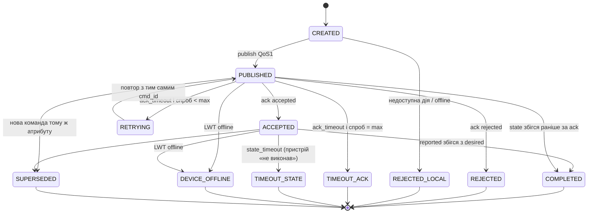

# Специфікація: диспетчеризація і контроль станів

Це центральна частина роботи: саме тут асистент відрізняється від простого
«голосового пульта».

## 1. Від наміру до команд

`Intent` (з NLU) → `TargetResolver` → список `DeviceCommand`.

1. **Розв'язання цілей.** За `device_type`/`device_name` + `room` + `group`
   знайти пристрої в `DeviceRegistry`:
   - є кімната і тип → пристрої цього типу в кімнаті;
   - лише тип, а пристрій такого типу один у будинку → він;
   - лише тип, кілька кімнат → помилка `ambiguous_target` з переліком кімнат;
   - група («все світло», «all lights») → усі пристрої групи (fan-out).
2. **Перевірка можливостей.** Дія підтримується типом? Значення в межах?
   Інакше — `unsupported_action` / `value_out_of_range` ще до відправки.
3. **Перевірка доступності.** Пристрій offline → одразу `DEVICE_OFFLINE`,
   команда не відправляється (асистент так і каже).
4. **Конфлікти.** Нова команда тому самому атрибуту пристрою скасовує
   (`SUPERSEDED`) попередню незавершену — останнє слово за користувачем.
   Уточнення: конфлікт — це **інше значення** спільного атрибута (тоді старий
   desired уже недосяжний). Однакові значення не конфліктують: «яскравість
   40 %» і «синій колір» обидві неявно містять `on: true` і обидві
   перевіряються до кінця.
5. Для кожного пристрою створюється `CommandRecord` і передається в
   `Dispatcher` → адаптер → MQTT.

Запити стану («яка температура у спальні?», «чи зачинені двері?») не
створюють команд: відповідь формується з `DigitalTwin`, з позначкою
свіжості («за даними 5 секунд тому»); якщо дані застарілі (stale) — асистент
про це попереджає.

## 2. Цифровий двійник

Для кожного пристрою зберігаються:
- `reported` — останній отриманий стан + `ts` + `seq`;
- `desired` — стан, якого ми домагаємося (з останньої команди), або `None`;
- `availability` — `online` / `offline` / `stale` (немає heartbeat > 3 × heartbeat_s);
- `last_seen`.

Пристрій вважається «узгодженим», коли `type.converged(desired, reported)`.

## 3. Життєвий цикл команди (скінченний автомат)

**Уточнення етапу 1** (гонки, яких немає на діаграмі вище; таблиця переходів
у `dispatch/tracker.py` — джерело правди):
- `CREATED → DEVICE_OFFLINE` — пристрій офлайн ще до відправки (як у §1.3);
  `REJECTED_LOCAL` лишається для недоступної дії / значення поза межами /
  недоступного брокера.
- Під час паузи перед повтором (`RETRYING`) можуть надійти спізнілий ack чи
  state попередньої спроби (той самий `cmd_id` — вони дійсні), LWT або нова
  команда: `RETRYING → ACCEPTED | REJECTED | COMPLETED | DEVICE_OFFLINE |
  SUPERSEDED`.
- `RETRYING → TIMEOUT_ACK` — остання спроба не змогла навіть опублікуватися
  (брокер недоступний).
- Події, що приходять після кінцевого стану (ack після COMPLETED), ігноруються.

- Автомат реалізується явно (таблиця переходів), недопустимий перехід = виняток
  (і тест). Кожен перехід — подія `CommandStatusChanged` з часовою міткою,
  тож для кожної команди відомі `t_published`, `t_ack`, `t_completed`.
- `state_timeout` залежить від типу: для світла 2 с, для штор
  `distance / speed + запас`, для воріт 12 с. Значення — у `settings.yaml`
  / в описі типу.
- Повтори: експоненційна пауза (0,5 с, 1 с), `max_attempts = 3`. Безпечно,
  бо пристрої ідемпотентні за `cmd_id`.

## 4. Агрегація для групових команд

«Вимкни все світло» → N команд. `CommandGroup` завершується, коли всі
дочірні в кінцевому стані. Відповідь: «Вимкнено 5 з 6 світильників, лампа
у дитячій не відповідає».

## 5. Health-моніторинг

- `availability` з retained-топіка і LWT → миттєве `offline`.
- Heartbeat: якщо `now - last_seen > 3 × heartbeat_s` → `stale`
  (пристрій «завис», з'єднання формально є — збій `freeze`).
- Зміна доступності → подія → веб-панель + (налаштовувано) голосове
  сповіщення «Замок вхідних дверей не на зв'язку».
- Неочікувана зміна стану без нашої команди (`drift`) — фіксується в журналі.

## 6. Відповідь користувачу (`ResponseComposer`)

Шаблони uk/en за результатом: `COMPLETED` → «Світло на кухні увімкнено»;
`TIMEOUT_ACK` → «Світло на кухні не відповідає»; `TIMEOUT_STATE` → «Команду
прийнято, але штори у спальні не змінили положення»; `DEVICE_OFFLINE`
→ «… зараз не в мережі». Для довгих дій (ворота, штори) — проміжне
«Відкриваю…» одразу після `ACCEPTED`, фінальне — після `COMPLETED`
(налаштовується).

## 7. Зберігання (SQLite)

| Таблиця | Поля |
|---|---|
| `voice_sessions` | id, started_at, trigger (wake/ptt/text), stt_engine, transcript, lang, confidence, t_speech_end, t_transcript, t_intent, t_response |
| `commands` | cmd_id, session_id, group_id, device_id, action, params_json, status, attempts, t_created, t_published, t_ack, t_finished, error |
| `state_history` | device_id, ts, state_json, source (report/drift) |
| `availability_log` | device_id, ts, status |

Журнал використовується веб-панеллю (історія) і бенчмарками (затримки).
